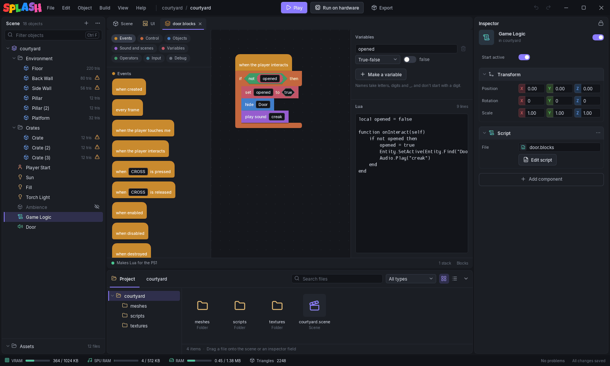

# The Block Editor

Blocks are a second way to write the same scripts. You snap blocks into stacks, and the editor writes the Lua for the console when the scene exports. Blocks and Lua are equals: use either, or mix them, even on one object. Blocks suit logic that is a chain of events and actions. Lua suits anything with tables, loops over data or the parts of the API blocks do not cover.

A blocks file is `scripts/<name>.blocks`, JSON text that diffs well in git. It goes anywhere a `.lua` file goes: an object's **Script**, a **Trigger box** script, or the scene script.

## Making and opening a block script

- On a Script component, **New blocks** writes `scripts/<object name>.blocks` with a **when created** stack and opens it. **Edit script** reopens it later.
- Double-click a `.blocks` file in the Project panel.
- The scene script has the same buttons in the scene settings; its starting stack is **when the scene starts**.

## The editor

Left to right:

- **Palette.** Category chips at the top (**Events**, **Control**, **Objects**, **Sound and scenes**, **Variables**, **Operators**, **Input**, **Debug**) and the blocks of the chosen category below. Hover a block to read what it does.
- **Canvas.** Drag blocks out of the palette and drop them here.
- **Variables** and **Lua**, on the right. The Lua panel shows the generated code as you build, with its line count, and lists anything that keeps it from running.

The status line says **Makes Lua for the PS1**. **Ctrl+S** saves, **Ctrl+Z** and **Ctrl+Y** undo and redo. Drag a block back to the palette (the canvas shows **Drop to delete**) or press **Delete** to remove it.

## Stacks, hats and inputs

A **stack** is a column of blocks. It starts with a **hat** block from **Events**; nothing runs until a stack starts with one. Statements snap under it, and a stack without a hat is loose and makes no code. Two stacks with the same hat are merged into one function, in the order they sit.

Rounded and pointed blocks (**Operators**, **Variables**, positions) are values. Drop them into the slots of other blocks: `if` takes a pointed true/false block, `move ... by` takes three numbers. Click a field in a block to type or pick a value: an object (**self** or any object in the scene), a controller button, a sound clip or a cutscene.

## Blocks

| Category | Blocks |
|----------|--------|
| **Events** | when created, every frame, when the player touches me, when the player interacts, when *button* is pressed, when *button* is released, when enabled, when disabled, when the scene starts, when the player enters the trigger, when the player leaves the trigger |
| **Control** | wait *n* seconds, if, if/else, repeat, while, repeat until, wait until, stop this script |
| **Objects** | show, hide, move by, move to, x/y/z position of, start particles, stop particles, burst particles |
| **Sound and scenes** | play sound, play cutscene, load scene |
| **Variables** | set, change by, and a block for each variable |
| **Operators** | numbers, text, true/false, + - * /, mod, pick random, join, = < >, and, or, not |
| **Input** | *button* held? |
| **Debug** | log, frame count |

The event hats are the same events as in Lua: **when created** is `onCreate`, **when the player interacts** is `onInteract`, and so on. See [Event Callbacks](../lua/events.md). **wait** blocks pause the stack and let the rest of the game run.

## Variables

**Make a variable** in the Variables panel, type its name and pick its kind: **Number**, **True-false** or **Text**. A variable belongs to this script. Names take letters, digits and `_` and cannot start with a digit; names that would clash with Lua keywords, the API tables or the event function names are refused.

Numbers with decimals are fine in blocks. The generated Lua writes `0.5` as a fixed-point value for you; see [Fixed-Point Math](../lua/fixed-point.md).

## Convert to Lua

Right-click the script's tab and pick **Convert to Lua...** to turn a blocks file into a Lua file. Every reference to the script follows. It is one way: the editor cannot turn Lua back into blocks, though **Ctrl+Z** undoes the conversion. Do it when a script outgrows blocks.

## What blocks do not cover

Blocks cover the events and actions in the table above. Everything else in the [API](../lua/api-reference.md), tables, and your own functions are Lua. Block scripts and Lua scripts in one scene work side by side.
