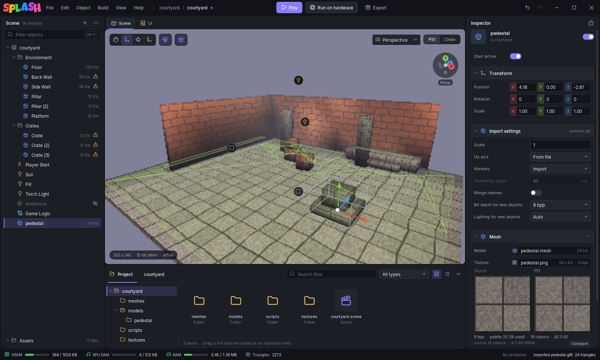

# Importing Models & Textures

## Models

The editor reads **glTF** (`.gltf`, `.glb`), **FBX** and **OBJ** (with its `.mtl`) directly, and **`.blend`** through Blender (see [Installation](../getting-started/installation.md#optional-extras)).

To bring a model in, drop the file on the viewport, on a row in the Scene tree (it becomes a child of that row), or into the Project panel. Choosing a model in a Mesh component's **Model** field works too. The editor copies the file into the project's `models/` folder, if it is not already there, and writes:

| File | What it is |
|------|------------|
| `models/<name>.mesh` | The whole model baked into one mesh, one submesh per material |
| `models/<name>/<node>.mesh` | One mesh per node of the model, for placing the parts as separate objects |
| `models/<name>_<n>.png` | The base colour textures its materials use |
| `models/<name>/<clip>.anim` | One file per animation in the file, for [skinned models](skinned-animation.md) |
| `models/<name>.<ext>.import.json` | The import settings, beside the source file |

Textures larger than 256 texels on a side are scaled down to fit a PS1 texture page. A texture the importer cannot find is a warning, not an error.

### Import settings

Select a model file in the Project panel and the inspector shows its **Import settings**. Each change re-imports the model and every copy placed in the scene.

| Setting | Effect |
|---------|--------|
| **Scale** | Multiplies the model's size. 1 keeps the size in the file, in metres. |
| **Up axis** | **From file** believes the file. **Y up** or **Z up** overrides it, for a model that comes in lying on its back. |
| **Normals** | **Import** keeps the file's normals (flat shading where it has none). **Recompute** works them out from the faces. |
| **Smoothing angle** | With Recompute: faces meeting at less than this angle are shaded smooth across the edge. |
| **Merge meshes** | On: each placed copy is one object drawing a single mesh. Off: the file's parts become child objects. |
| **Bit depth for new objects** | The [texture bit depth](materials.md#texture-bit-depth) of objects made from this model from now on. |
| **Lighting for new objects** | Whether runtime lights light these objects; see [Lighting](lighting.md#dynamic-lighting). |

Merging objects also cuts the RAM each object costs at load. A scene with over a thousand objects can run out of RAM on object count alone, and the scene settings then offer to select the biggest group. **Merge meshes** is the fix.

Every warning from the last import is listed under the settings with a suggested fix.

## Textures

Textures are PNG files. Assign one in a Mesh component's **Texture** field (one per material) by clicking the field and picking a file, or by dragging it from the Project panel. The editor converts it to PS1 colours on export.

Under the texture field, a preview shows the **Source** next to the **PS1** result, with the bit depth, palette size, colour count and an error figure. If the PS1 version looks wrong, this is where you see why before you press Play.

See [Materials & Bit Depth](materials.md) for what 4, 8 and 16 bpp cost.
