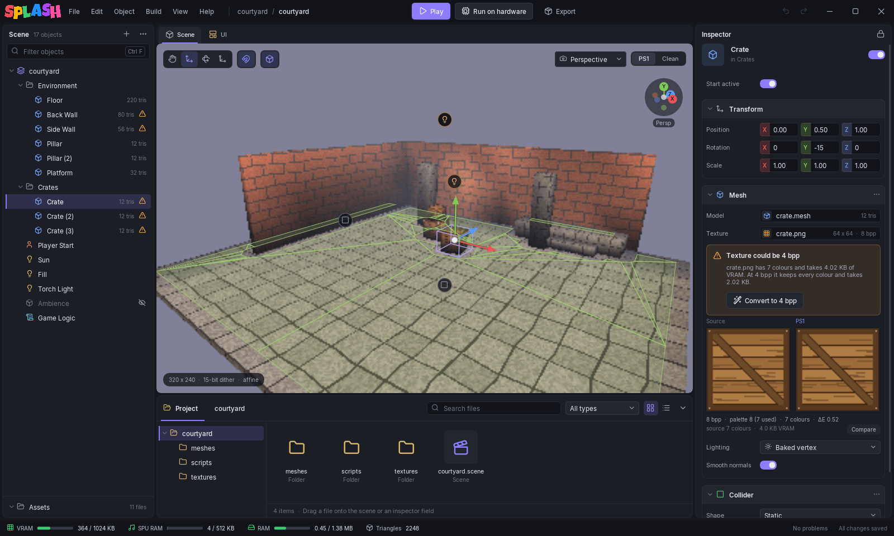

# The Editor

The window has five areas: the title bar with the menus and the run buttons, the **Scene** panel, the middle panel (viewport, script tabs and UI), the **Inspector**, and the status bar. The **Project** panel docks under the middle panel.

## Title bar

**File**, **Edit**, **Object**, **Build**, **View** and **Help** menus, then the project and scene name (a dot after it means unsaved changes), then **Play**, **Run on hardware** and **Export**, and undo/redo.

| Menu | Holds |
|------|-------|
| **File** | New Project, Open, recent scenes, Save, Save As, Quit |
| **Edit** | Undo, Redo, Rename, Duplicate, Cut, Copy, Paste, Delete, Select None |
| **Object** | Add Object, Add Component, Frame Selection (++f++), Align with View (++ctrl+shift+f++) |
| **Build** | Play, Run on Hardware, Export Disc Image, and the two [debug overlays](../getting-started/play-and-export.md#debug-overlays) |
| **View** | Transform tools, PS1 Look / Clean Look, Snap, Orthographic, the scene's scripts, the Project panel, and the Timeline with every cutscene and animation |
| **Help** | Documentation, Report a Problem |

**Save As** keeps the scene inside the project folder, since every path in it is relative to that folder.

## Scene panel

The scene as a tree of objects. The header shows the object count; **+** adds an object and **...** has more.

- Click to select. Double-click frames the object in the viewport.
- Drag rows to reorder or reparent. Drop a model file on a row to import it as a child.
- ++ctrl+f++ filters the tree by name.
- Right-click for **Rename**, **Duplicate**, **Cut**, **Copy**, **Paste**, **Delete**, **Move to Top Level**, **Frame in View** and **Pin in Inspector**.

Each mesh row shows its triangle count. A warning sign means the inspector has a problem or a suggestion for that object. A crossed-out eye marks an object that starts inactive.

The tree is for organising. At export the hierarchy is flattened into world positions, so moving a parent from Lua does not move its children. See [`Entity.SetParent`](../lua/api-reference.md#parenting) to attach objects at runtime.

## Viewport

The toolbar at the top left picks the transform tool: **Hand** (++q++), **Move** (++w++), **Rotate** (++e++) and **Scale** (++r++). Next to them:

- **Snap** to a 0.25 m grid. With snap off, hold ++ctrl++ while dragging to snap.
- **Overlays**: trigger boxes, interaction radii and navigation regions.

At the top right, **Perspective** / **Orthographic** and the view mode:

- **PS1** draws the scene the way the console will: 320x240, 15-bit colour with dithering, affine texture mapping, the exported vertex lighting and fog. The caption at the bottom left says so.
- **Clean** draws it plainly, for placing things.

The axis widget at the top right shows the camera's orientation.

| Input | Does |
|-------|------|
| Left click | Select (with Hand, left drag pans) |
| Right drag | Look around; hold ++w++ ++a++ ++s++ ++d++ ++q++ ++e++ to fly, wheel sets the fly speed |
| Middle drag | Pan |
| Wheel | Move in and out |
| ++alt++ + left drag | Orbit |
| ++alt++ + right drag | Zoom |
| ++f++ | Frame the selection; ++shift+f++ keeps following it |
| ++ctrl+shift+f++ | Move the selection to the camera (Align with View) |

## Middle panel tabs

- **Scene**: the viewport.
- **UI**: the scene's UI canvases at PS1 resolution. See [UI Canvases](ui-canvas.md).
- One tab per open script: `.lua` files open in the [Lua editor](lua-editor.md), `.blocks` files in the [block editor](block-editor.md).

## Inspector

The selected object's name, its **Start active** switch, then one section per component. Most sections have a switch to turn the component off, and a **...** menu with **Remove component**. **Add component** at the bottom adds another. See [Objects & Components](objects.md).

The lock at the top right pins the inspector to the current object, so you can select others (for example to drag them into a field) while it stays put.

With nothing selected (**Edit > Select None**, or click empty space in the viewport), the inspector shows the [scene settings](scene-settings.md).

Inspector cards flag problems and offer a one-click fix: a texture that could be 4 bpp, a mesh with no vertex colours, a player with no ground to walk on.

## Project panel

The project folder: a folder tree on the left, the files on the right as a grid with thumbnails or as a list. Search and the type filter (**Models**, **Meshes**, **Textures**, **Scripts**, **Audio**, **Animations**, **Scenes**, **Fonts**) cover the whole tree.

- Drag a file onto the viewport, a scene tree row or an inspector field to use it.
- Double-click: a scene opens, a script opens in its editor, a model or mesh is placed in the scene, anything else opens in your system's default app.
- Right-click for **Rename** (++f2++), **Delete**, **Reveal in file manager**, and **Reimport** on a model.

Renaming or moving a file updates every scene in the project that uses it. Deleting is refused while something still uses the file; deleted files go to a hidden `.trash/` folder in the project and are emptied after 30 days, and ++ctrl+z++ brings them back.

**View > Project** shows or hides the panel. The **Timeline** opens as a second tab in the same dock.

## Status bar

Live budgets for the scene as it would export right now:

| Meter | Budget |
|-------|--------|
| **VRAM** | 1024 KB: framebuffers, textures, CLUTs and font |
| **SPU RAM** | 512 KB: audio clips |
| **RAM** | Main RAM left for the scene after the engine: scene data, render buffers, per-object costs |
| **Triangles** | Triangles in the scene |

The editor exports the scene in the background a moment after each edit and updates the meters. On the right: **No problems** or the number of export errors and warnings (click to list them), and whether everything is saved.

See [Memory & Performance](../reference/memory.md) for what fills each budget.
