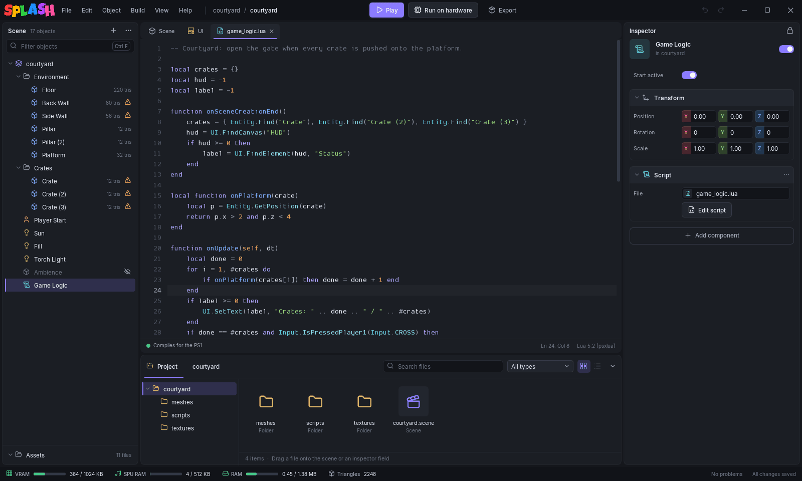
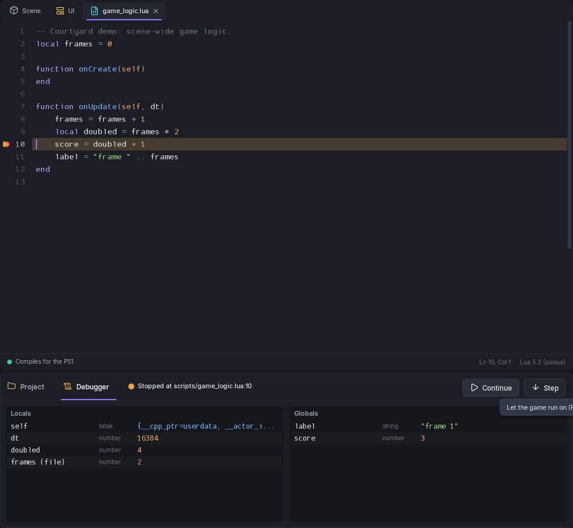

# The Lua Editor

Lua files open in a tab next to **Scene** and **UI**. Open one by double-clicking it in the Project panel, or with **Edit script** on a Script component. **New Lua** on a Script component writes `scripts/<object name>.lua` with `onCreate` ready to fill in and opens it. See [Lua scripting](../lua/index.md) for the language and the API.

You can write every script in Lua, build every script from [blocks](block-editor.md), or mix them in one scene. Neither is the default, and both end up as the same Lua on the console.

## What the editor does for you

- **Highlighting** for Lua 5.2 and the psxsplash API.
- **Compile check.** A moment after you stop typing, the script is compiled the way the exporter will compile it. The bar at the bottom reads **Compiles for the PS1**, or shows the first error with its line; click it to jump there, and a squiggle marks the spot.
- **Autocomplete.** Type `Entity.` and the list shows every function in the table, with its signature. **Ctrl+Space** opens the list on demand. **Enter** or **Tab** accepts. Your own functions and variables are listed too.
- **Signature hints** while you type the arguments of a call.
- **Go to definition.** **Ctrl+click** a name, or press **F12**, to jump to where your script defines it. Hovering an API function shows what it does.
- **Find and replace.** **Ctrl+F** finds, **Ctrl+H** replaces. Options: **Match case**, **Whole word**, regular expression (with `$1` in the replacement) and **Preserve case**, plus **Find in selection**. **F3** and **Shift+F3** step through matches; **Ctrl+Alt+Enter** replaces all in one undo step.
- **Ctrl+/** comments the selection. **Tab** and **Shift+Tab** indent and outdent.
- **Ctrl+S** saves; **Ctrl+Z** and **Ctrl+Y** undo and redo. The status bar shows the line and column, and `Lua 5.2 (psxlua)`.

Press **Play** and open scripts are saved first.

## Breakpoints

Click in the gutter, left of the line numbers, to set a breakpoint on that line. A red dot marks it; a faint dot shows under the pointer. Click the dot again to clear it. Breakpoints are saved in `.breakpoints.json` in the project folder. It is hidden from the Project panel and is not part of any scene.

Press **Play**. When the game reaches a marked line it stops before running it. The script opens at that line, which gets an amber highlight and an arrow, and a **Debugger** tab appears in the bottom dock. It reads **Stopped at** the script and line (click it to show the line again) and has two columns:

- **Locals**: the locals of the function that stopped. File-level locals the function uses are marked `(file)`.
- **Globals**: the script's own globals. Functions and the engine's API tables (`Entity`, `Debug`, `Input` and the rest) are left out.

The tab is there while a one-player Play has an engine with the debugger running. While the game runs, **Continue** and **Step** are drawn disabled.

- **Continue** (**F8**) lets the game run until the next breakpoint.
- **Step** (**F10**) runs to the next line that executes anywhere in Lua. That may be the next line of the same function, or a line in another object's script. Returning from a function that was called from C is not treated specially.

F8 and F10 work wherever the keyboard focus is. A breakpoint you add while the game is stopped takes effect when it resumes.

### Debug info only while breakpoints exist

Line numbers and local names roughly double the size of the compiled scripts, and the console loads them into memory along with the code. Play therefore only includes them while the project has at least one breakpoint. If you set your first breakpoint while a Play without any is running, the editor reloads the scene with the debug info and the game then stops there. Disc builds and **Export** never include it, so they come out the same as before.

### Limits

- Only **Play** stops. **Run on hardware** does not use breakpoints.
- With 2 to 4 linked players the debugger is off.
- Scripts built from [blocks](block-editor.md) take no breakpoints.
- A breakpoint is a fixed line number. It does not move when you add or remove lines above it, or when you rename or move the script.
- Values are shallow. A table shows its first 6 fields, long strings are cut, and a `FixedPoint` value shows as a table. There is no call stack, no watch list and nothing to expand.
- The engine has to have the feature. With an older engine the Debugger tab does not appear and the game runs as before.

### Without the editor

The editor drives the engine through two files in the PCdrv folder. `luabp.txt` holds a generation number on the first line, then one `<line> <chunk>` per breakpoint, where the chunk is the script's project path. The engine reads it when the scene loads and again every 15 frames. While stopped, the engine prints `psxsplash: lua break <id> <line> <chunk>` followed by `lua local`, `lua upvalue` and `lua global` lines, then `lua break end <id>`. Write `<id> continue` or `<id> step` to `luabp.cmd` to resume; a command with a different stop id is ignored. The scripts must have been compiled with debug info.

## Files changed outside the editor

If a script changes on disk while it is open (your own text editor, git) and the tab has unsaved edits, the tab says **Changed on disk** and offers **Reload** or **Keep mine**. **Ctrl+Z** after a reload brings your edits back. A file deleted on disk can be written again with **Save**.

Closing a tab with unsaved edits asks first: **Save**, **Don't save** or **Cancel**.

## Using VS Code or another editor

**View > Set up external editor (VS Code)** writes two files into the project folder:

- `psxsplash.d.lua`, the psxsplash API as [lua-language-server](https://luals.github.io/) definitions: completion and signatures for every table and function, with hover docs where the API reference has them, made from the same list the editor's autocomplete uses.
- `.luarc.json`, which sets Lua 5.2 and turns off the libraries the PS1 does not have (`math`, `io`, `os`, `require`). It is only written when the project has none, so your own settings are kept.

Open the project folder in VS Code with the **Lua** extension (sumneko) installed. When a newer editor opens the project, it brings `psxsplash.d.lua` up to date on its own.

## Fixed-point numbers

The PS1 has no floating-point unit, so a decimal like `0.5` is not a number in these scripts. Read [Fixed-Point Math](../lua/fixed-point.md) first. The compile check accepts what the compiler accepts, so it will not flag a script that does the wrong arithmetic.
