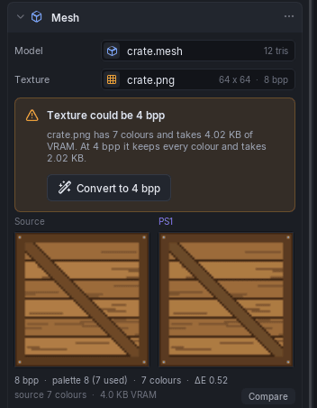

# Materials & Bit Depth

A mesh has one **material** per submesh. Each material is a **Texture** (a PNG) and a **Colour**. With a texture, the colour is not shown in the inspector; without one, the material is that flat colour.

## Texture bit depth

VRAM is 1 MB and every texture lives there, so bit depth is the biggest lever you have.

| Depth | Colours | VRAM per texel | Notes |
|-------|---------|----------------|-------|
| **4 bpp** | 16 | 4 bits | Needs a 16-entry palette (a CLUT). Smallest. |
| **8 bpp** | 256 | 8 bits | Palette of 256. The default for new meshes. |
| **16 bpp** | 32768 | 16 bits | No palette; 15-bit colour. Largest. |

The depth is per mesh component. The inspector shows it next to the texture's size, for example `64 x 64 · 8 bpp`. **Compare** under the preview flips between the source and the PS1 result.

### The 4 bpp suggestion

When every texture on a mesh has 16 colours or fewer, and 4 bpp would use less VRAM, the inspector shows a card:

> **Texture could be 4 bpp**: crate.png has 7 colours and takes 4.02 KB of VRAM. At 4 bpp it keeps every colour and takes 2.02 KB.

**Convert to 4 bpp** applies it in one undo step. The scene tree marks the object with a warning sign until you do. The suggestion never appears for textures with more than 16 colours; those would lose colour at 4 bpp, and the PS1 preview under the texture field shows exactly how much.

To change the depth the other way, set **Bit depth for new objects** in the model's [import settings](importing.md#import-settings) and re-place the model.

## Mesh colours and lighting

**Lighting** on a mesh picks where its vertex colours come from:

| Option | Meaning |
|--------|---------|
| **Baked vertex** | Light from the scene's lights is baked into the vertices at export. Costs nothing at runtime. |
| **Flat** | One flat colour. |
| **Mesh colours** | The colours stored in the model file. A model with none shows flat grey (127, 127, 127), and the inspector says so with a **Use baked lighting** fix. |

**Smooth normals** (Baked vertex only) bakes the lighting as if the surface were smoothly curved. Off keeps the model's own normals, for hard edges.

## Limits worth knowing

- Textures are at most 256 x 256; larger images are scaled down on import.
- All of a scene's textures share VRAM with two framebuffers and the font column. The **VRAM** meter in the status bar shows the total; the scene settings' **VRAM layout** shows where each atlas sits and lets you [reserve areas](scene-settings.md#vram-layout).
- Several materials on one mesh each take their own texture.

See [Memory & Performance](../reference/memory.md).
