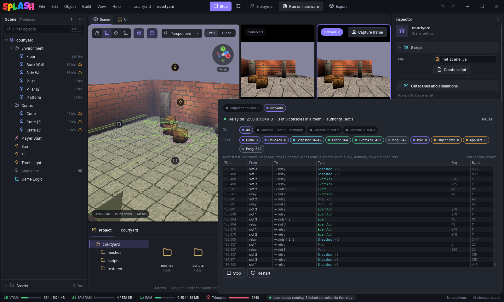
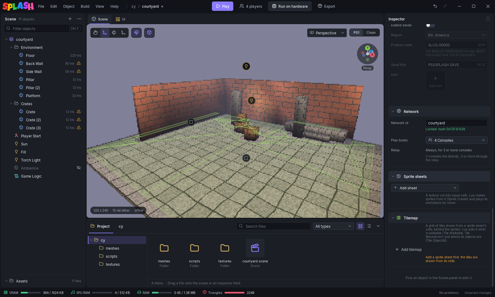

# Multiplayer

psxsplash games can link up to 10 consoles. The engine talks over the PlayStation's second serial port (SIO1, the link-cable port), and the scene's Lua sends and receives with the [`Net` table](../lua/api-reference.md#net). In the editor you set the scene's network id, and **Play** can boot up to 10 linked consoles at once.



## Scene > Network

With no object selected, the inspector shows the [scene settings](scene-settings.md); **Network** is one of their sections.



**Network id**: consoles linked with `Net.Connect` only connect when their scenes have the same id.

Left empty, the id is derived at run time from the scene index and the object count. That number changes when objects are added, so consoles running different builds of the same scene may not connect. Different scenes can also collide on the same derived id. While the id is empty, a **Use "&lt;scene&gt;"** button sets it to the scene's name; Ctrl+Z puts it back. A set id is shown as **Locked: hash 0x...**. The hash depends only on the id, so later builds of the scene keep it.

**Play boots** sets how many consoles the next **Play** starts, from **1 Console** to **10 Consoles**. The **Relay** switch sends 2 consoles through the editor's relay; with it off they link directly. 3 or more always use the relay, so the switch is hidden. Both settings are saved in your editor settings. The scene file does not store them.

The same choices are on the **Players** button right of **Play** in the toolbar (also **Build > Players**). Its label is **1 player**, **2 linked**, **2 via relay** or **4 players**, and its list ends with **Use the Relay for 2 Consoles**.

## Playing with several consoles

Each console is a separate pcsx-redux.

- **2 consoles, linked directly.** The emulators are joined over SIO1, the way PlayStations are joined by a link cable. Console 1 is the link's server, console 2 its client.
- **3 to 10 consoles, through the relay.** The editor runs a relay on 127.0.0.1 and each console connects to it. The relay groups consoles into rooms by network id, gives each one a slot from 1 to 10 (slot 0 is the relay) and passes events, data and positions between them.

The console that has the keyboard is outlined.

## The status line

Under each console, a line shows what the engine reports about the link:

| Status line | Meaning |
|---|---|
| **Not linked: the scene has not called Net.Connect()** | No script has started a session. |
| **Connecting...** | `Net.Connect` ran and is waiting for the other side. |
| **Linked · slot 0 · host · 2 players** | Connected: this console's slot, whether it is the host, and how many players there are. |
| **Link refused: the other console runs another engine version** | The engines use different protocol versions. |
| **Link refused: the other console runs another scene** | The network ids differ. |

With an empty Network id, the line ends with **no Network id: set one in Scene > Network**. Through the relay, it starts with the relay slot and the authority: **Relay slot 2 · authority slot 1**, or **Relay slot 1 · authority** on the authority.

## The Network view

When the relay runs, the output panel has an **Output of console N** chip (what the console with the keyboard printed) and a **Network** chip, the packets the relay routed.

The head line looks like **Relay on 127.0.0.1:34613 · 3 of 3 consoles in a room · authority: slot 1**. **Pause** freezes the list; the relay keeps routing.

- **Slot** filters by console. A chip shows the console's slot and **authority** on the room's authority, or **no slot** / **gone**. **All** shows them all.
- **Type** turns packet types on and off: Hello, HelloAck, Snapshot, Event, EventAck, Ping, Pong, Bye, ObjectState, AppData. Each chip shows a count.

The list is newest last, with Time, From, To, Type, Seq and Bytes. Snapshots, Pings and Pongs a console sends within a second share a row. When the authority's console quits, the hand-off gets a row, such as **Authority slot 2 (was 1)**.

## Host authority

One console in a session is the **host**. It owns the shared world objects: the actors a script registered with `Net.RegisterActor`. The host sends their position and facing in its snapshots. On the other consoles, those actors are moved to the host's values. `Net.SyncActor` follows the same rule: only the host's sync is applied.

Which console is host depends on the link:

- **Direct link:** both consoles roll a random number during the handshake. The higher number becomes host in slot 0; the other console gets slot 1.
- **Relay:** the first console in a room is the authority. When it quits, the lowest slot still in the room takes over. A console that joins later into a freed lower slot does not.

Player avatars are not host-owned: each console sends the position of its player.

## The Lua side

`Net.Connect()` starts the session. The functions that take an actor want a handle from `Actor.Find`.

- `Net.Send(id, arg)` sends a pair of integers reliably. The other consoles' scene scripts receive them in `onNetEvent(id, arg)`.
- `Net.SendData(str)` sends a string of up to 256 bytes reliably and in order. The others get it in `onNetData(str)`.
- `Net.SetLocalAvatar(actor)` sets which actor this console sends as its player (the player by default). `Net.SetRemoteAvatar(slot, actor)` sets the local object that shows another slot's player.
- `Net.RegisterActor(actor)` makes an actor host-owned; up to 48 per scene. `Net.SyncActor(actor)` sends that object's `self.sync` table.
- `Net.IsHost()`, `Net.LocalSlot()` and `Net.PlayerCount()` describe this console's place in the session. `Net.State()` returns 2 once connected.

This object script registers a crate, and each 60 frames the host pushes it along and the other consoles see it move. Each console also sends an event:

```lua
local crate, frames = nil, 0

function onCreate(self)
    Net.Connect()
    crate = Actor.Find("Crate (3)")
    if crate then Net.RegisterActor(crate) end
end

function onUpdate(self, dt)
    if Net.State() ~= 2 or not crate then return end
    frames = frames + 1
    if frames < 60 then return end
    frames = 0
    if Net.IsHost() then
        Actor.SetPosition(crate, Vec3.add(Actor.GetPosition(crate), Vec3.new(2, 0, 0)))
    end
    Net.Send(7, Net.LocalSlot())
end
```

And in the scene script:

```lua
function onNetEvent(id, arg)
    Debug.Log("event " .. id .. " from slot " .. arg)
end
```

## Real hardware

On a PlayStation the engine uses the same serial port, so a pair of consoles join with a link cable. The relay listens only on 127.0.0.1 for Play's emulated consoles.
