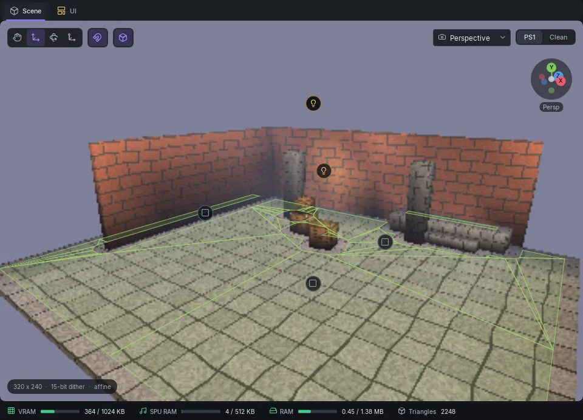

# Player, Navigation & Rooms

## The player

One **Player** component per scene marks where the player starts and how it moves (fields in [Objects & Components](objects.md#player)). Put the **Player** component where you want the player to start; the exporter drops its start point straight down onto the nearest upward-facing floor within 100 units and raises it by the player's **Height**.

The player walks on a **navigation mesh** baked from your geometry, not on physics:

1. Give floors and ramps a **Collider** set to **Static**.
2. The export bakes walkable regions from static colliders that are flat enough (**Max slope**), wide enough (**Radius**) and reachable by steps no taller than **Step height**.
3. The player stays on those regions. Static walls stop it.

If the bake finds nothing, the inspector says **The player can't walk**: with no ground, the camera stays at the origin and the controller is ignored. When meshes lack a collider, **Make meshes walkable** gives them a Static one.

### Seeing the bake

Select nothing, and the scene settings have a **Navigation** section: the number of regions and portals, and switches for **Show in viewport** (region outlines), **Labels** (R0, R1 ... click one to select it) and **Portals** (the edges the player can cross between regions). **Region** shows a selected region's floor height and surface.

### The Navigation component

A **Navigation** component bakes walkable ground without a player, or overrides the player's bake: **Agent height**, **Agent radius**, **Step height**, **Max slope**. If the scene has one, its values win.

Finer bake settings (cell size, region merging) are in the scene file and keep their defaults; see the scene format notes in the editor's repository.

## Colliders and triggers

| Component | Does |
|-----------|------|
| **Collider: Static** | Walkable and solid scenery. Part of the nav bake. |
| **Collider: Dynamic** | A box tested against the player every frame. Fires `onCollideWithPlayer`. Scripts can move it. |
| **Trigger box** | A volume that calls `onTriggerEnter(index)` and `onTriggerExit(index)` on its own script. |
| **Interactable** | Calls `onInteract` when the player presses a button within **Radius**. |

A dynamic collider's box does not turn when you rotate the object.

## Rooms and portals

Indoor scenes draw faster if only the rooms the camera can see are drawn. Add **Room** objects as boxes around areas, and **Portal** objects on the openings between them.

- **Room**: **Size** and **Offset** are the box in metres. Each static triangle goes to the room whose box holds most of its corners; triangles that fit none go to a catch-all room that is always drawn. The component shows what the last export made of it: triangles, cells and portals.
- **Portal**: **Room A** and **Room B** pick the two rooms (by name, so keep Room names unique) and **Width** and **Height** size the opening on the object's X and Y axes. The viewport's arrow points from A into B. From either room, the camera sees into the other through the portal.

The scene settings read **Culling: rooms and portals, N rooms** once one Room exists; with none it reads **Culling: frustum (BVH)**. The **Scene type** dropdown is stored but not read by the engine: culling follows the Rooms.

A scene holds at most 31 Rooms. A portal with a missing, duplicated or identical Room names shows what to fix under the component, and the export stops until you do.

Press **Build > Room Debug Overlay** and then Play to see each room's wireframe in the game.
