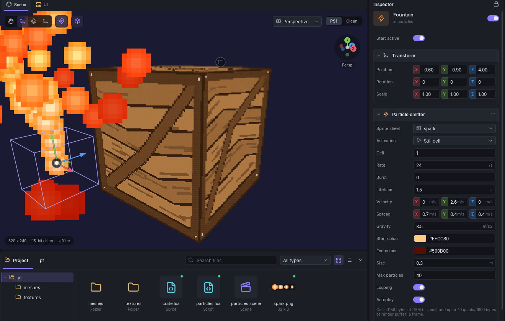

# Particle Emitters

A **particle emitter** is a component that throws out small camera-facing pictures, cut from one of the scene's [sprite sheets](sprites.md): sparks, smoke, dust, a fountain. It is the engine's way to draw many short-lived 2D effects among the 3D geometry. Lua and Blocks start and stop an emitter by the name of its object.



Add it from **Add component** at the bottom of an object's inspector. The object needs no mesh: an empty object with an emitter is the usual case. The emitter's section is the last one in the inspector.

!!! warning "Needs a matching engine"
    A scene with an emitter is exported as **splashpack v31**, which has a longer header than older packs. An engine built before particle support cannot read it. Use the engine that ships with the editor. Scenes without emitters are exported as before.

## Fields

| Field | Meaning |
|-------|---------|
| **Sprite sheet** | The scene sprite sheet the particles are cut from. Needs at least one sheet under **Scene > Sprite sheets**. |
| **Animation** | **Still cell**, or one of that sheet's animations. An animation plays over each particle's life from its birth, at the animation's own frame time. Changing the sheet clears it. |
| **Cell** | The sheet cell every particle shows, counted row by row from 0. Only shown with **Still cell**. |
| **Rate** | Particles spawned a second while it plays, 0 to 600. 0 means only the burst. |
| **Burst** | Particles spawned at once when it starts (`Particles.Play`), 0 to 256. |
| **Lifetime** | Seconds each particle lives, 1/60 to 60. Every particle of an emitter lives the same time. |
| **Velocity** | Start velocity in metres a second, in the object's own space: rotate the object to aim the emitter. |
| **Spread** | A random amount, up to this value either way, added to each start velocity, per world axis. Negative values are stored as positive. |
| **Gravity** | Metres a second per second, -100 to 100. Positive pulls the particles down, negative floats them up. |
| **Start colour** | The tint at birth. 50% grey (`#7F7F7F`) draws the sheet's own colours; brighter doubles them. |
| **End colour** | The tint at the end of the life. The colour changes evenly from start to end. |
| **Size** | The billboard's width in metres, 0.01 to 20. Its height follows the cell's shape. |
| **Max particles** | The pool: how many of this emitter's particles can be alive at once, 1 to 256. A spawn into a full pool is dropped. |
| **Looping** | On: emits until `Particles.Stop`. Off: a one-shot emitter that emits for **Duration** each time it plays. |
| **Duration** | Seconds a one-shot emitter spawns for, 0 to 600. Only shown with **Looping** off. |
| **Autoplay** | On: starts when the scene loads. Off: waits for `Particles.Play` or a Blocks **start particles**. |

The line under the fields reads the emitter's cost, and the Lua calls for its name. If rate times lifetime needs more particles than the pool holds (a looping emitter), a warning says how many it needs and that the rest are not spawned: raise **Max particles** or lower the rate.

An emitter on a moving game object follows it: the emitter's position is then relative to that object. Positions are 20.12 fixed point in the engine, with extra precision inside the simulation, so even a very slow particle moves smoothly.

## Cost

The budget is in two parts, and both show in the editor.

- **RAM.** One block is allocated when the scene loads and freed when it unloads: **36 bytes per emitter** plus **28 bytes per particle** of every pool. Nothing is allocated while the scene runs. The pool is counted whether or not the particles are alive, so **Max particles** is the number to keep low. It is added to the RAM meter in the status bar.
- **Drawing.** Each particle that is drawn takes **one 40-byte quad** of the frame's render buffer. The exporter adds 40 bytes times each emitter's pool to the buffer size it writes, so the worst case always fits.

When a scene has emitters, the status bar also shows a **Particles** meter: the number of emitters, the most particles they can hold at once, and the RAM they take. The inspector shows the same two numbers for the selected emitter.

Time is in vsyncs, 60 a second, whatever frame rate the scene runs at, up to 8 steps a frame. Each particle also costs GPU and CPU time to transform and draw; this is **not measured on real hardware**, only in an emulator. The limits below allow 8192 particles, and nothing stops a scene from asking for that many.

## Limits and build errors

The build stops on:

- more than **32 emitters** in the scene (counting active objects);
- more than **256 particles** in one emitter's pool;
- an emitter with no sprite sheet, or one that names a sheet that does not exist;
- an animation the sheet does not have;
- a cell outside the sheet.

Warnings, which do not stop the build:

- the pool is too small for rate times lifetime;
- two emitters with the same object name. `Particles.Find` returns the first.

Renaming a sprite sheet or an animation does **not** update the emitters that use it: they show the "no such sheet" warning and the build fails until you pick again. Renaming the emitter's object does not update the names in your Lua scripts or Blocks either.

## How it is drawn

Particles are drawn after the 3D geometry and the blob shadows, each at its own depth, so geometry in front of a particle hides it and the other way round. A particle is left out when it is nearer than the camera's near plane, farther than the scene's draw distance or fog wall, or off screen. Its size on screen is its **Size** scaled by distance, between 1 and 256 pixels wide.

Known limits:

- **Not fogged before the fog wall.** A particle is culled past the wall but keeps its full colour until then.
- A particle in the same ordering-table bucket as a triangle is drawn behind that triangle; there is no finer ordering inside a bucket.

## Scene view preview

The Scene view plays every emitter in the scene, so you see the effect while you edit. It runs the same integer simulation as the engine, so the particles match what the console draws. The preview ignores **Autoplay**, loops a one-shot emitter half a second after its last particle dies, and draws on top of the 3D view without depth: a crate does not hide the particles behind it, as it would on the console.

## Starting and stopping from Lua

Each emitter is found by the name of its object. The full list is in the [`Particles` API](../lua/api-reference.md#particles).

```lua
function onInteract(self)
    Particles.Burst("Sparks", 12)       -- 12 at once, playing or not
end

function onCreate(self)
    if not Particles.IsPlaying("Fountain") then
        Particles.Play("Fountain")
    end
end
```

`Play` restarts emission and starts the random spread again from the emitter's seed, so every `Play` looks the same. `Stop` lets the live particles finish their lives.

### In Blocks

The **Objects** category of the [Block Editor](block-editor.md) has three blocks with an **Emitter** field that lists the scene's objects with an emitter: **start particles**, **stop particles** and **burst *n* particles from**. They produce `Particles.Play`, `Particles.Stop` and `Particles.Burst` with the object's name.
