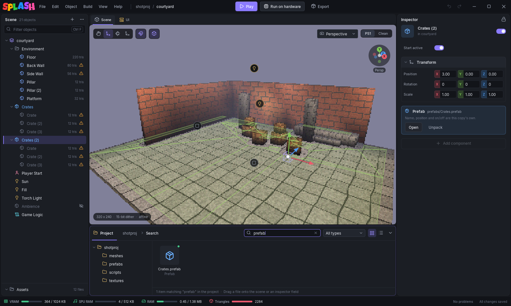

# Prefabs

A **prefab** is a group of objects saved in its own file so you can place it many times: a door, a pickup, a lamp post, a stack of crates. Every copy placed in a scene is an **instance**. Change the prefab once and all its instances, in all scenes, follow.

## Making a prefab

Build the group in a scene first: one object with the others as its children. Then right-click it in the **Scene** panel and choose **Create Prefab**. The editor writes `prefabs/<name>.prefab` in the project (`<name> (2).prefab` if that file exists; an existing file is not overwritten) and the object becomes the first instance of it. Ctrl+Z turns it back into plain objects and leaves the file on disk.

A prefab file is plain text, like a scene, so it diffs and merges cleanly in version control.

## Placing instances

Drag a `.prefab` file from the **Project** panel into the viewport or into the Scene panel. The new instance is named after the prefab and numbered if the name is taken.

In the Scene panel an instance's children are drawn greyed. You can select them to look at their settings, but they are read-only: the inspector names the prefab they are part of, with **Open prefab** and **Select instance** buttons. Clicking an instance in the viewport selects the instance itself.

## What an instance keeps

Each instance has a separate:

- name,
- **Active** and **Start active**,
- position, rotation and scale.

Everything else (components, children, their settings) comes from the prefab. An instance's inspector shows a **Prefab** card with the file path, **Open** and **Unpack**. Components cannot be added to or removed from an instance.

When the prefab contains an [agent](agents.md), the waypoints move and turn with the instance.

## Editing a prefab

**Open** (on the Prefab card, or **Open Prefab** when you right-click an instance) switches the editor to the prefab: the Scene panel shows only its objects, under a bar reading **Editing prefab** with a **Back** button. Edit it like any scene: add children, change components, move things. A prefab without lights of its own is drawn under neutral light so you can see it.

**Back** saves the prefab, returns to the scene and refills its instances from the saved file. Opening another scene, starting a new project or quitting also saves it. While a prefab is open the status bar does not show the scene's memory budgets and no live export runs.

## Unpacking

**Unpack** (or **Unpack Prefab** on the right-click menu) copies the prefab's objects into the scene as plain objects and removes the link. The copy no longer follows the prefab, and you can edit or rename anything in it. It is one undo step.

## Names inside prefabs

Objects inside an instance keep the names they have in the prefab, so two instances of one prefab both contain, say, a `Hall`. That matters only where something finds an object by name: a [Portal](navigation-rooms.md)'s rooms, a cutscene track's target, a player's spawn anchor. When such a name exists twice because of instancing, **Problems** warns:

> Prefab prefabs/wing.prefab: 2 objects are named 'Hall' (...) and Portal 'Door' refers to it by name, so only one of them is meant. Unpack an instance and rename it.

## Exporting

Instances export byte for byte like the same objects placed by hand: the splashpack does not know prefabs exist. If an instance's prefab file is missing or cannot be read, the export stops and Problems names the instance, for example `Crates: prefab prefabs/Crates.prefab not found`.

Moving or renaming a `.prefab` in the Project panel updates the scenes that use it, and moving a mesh, texture or script that a prefab uses updates the prefab.
