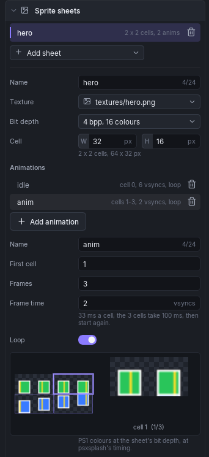

# Sprite Sheets

A **sprite sheet** is a texture cut into a grid of equal cells, plus named **animations**: runs of cells the engine plays one after another. Lua makes sprites from a sheet and plays its animations by name. Use them for 2D characters, effects, pickups and anything else drawn as a flat picture over the scene.



Sheets belong to the scene, not to an object. With nothing selected (**Edit > Select None**, or click empty space in the viewport) the inspector shows the scene settings; the **Sprite sheets** section is among them.

## Sheets

**Add sheet** opens a list of the project's images. Pick one and the editor adds a sheet named after the file (with a number in brackets if that name is taken), with 16 x 16 cells, 4 bpp and one animation called `idle`. The list above it shows each sheet with its grid and animation count; click one to edit it, the bin deletes it with its animations. When the texture does not divide into cells the row shows only the animation count, in orange.

| Field | Meaning |
|-------|---------|
| **Name** | What Lua finds the sheet by: `Sprite.Create("hero")`. At most 24 characters, unique in the scene. |
| **Texture** | The image cut into cells. Cells are numbered row by row from 0 at the top left. |
| **Bit depth** | **4 bpp, 16 colours**, **8 bpp, 256 colours** or **16 bpp, direct colour**. 4 bpp takes a quarter of the VRAM of 16 bpp. |
| **Cell** | Width (**W**) and height (**H**) of one cell in pixels, 1 to 255. The line under it shows the grid, for example "2 x 2 cells, 64 x 32 px", or says the texture is not a whole number of cells. |

## Animations

Each sheet has its own list of animations. **Add animation** adds one called `anim` (numbered if taken) that starts on the cell after the sheet's last animation ends (or on cell 0 when that is past the end of the sheet). Click an animation to edit it; the bin deletes it. The row shows its cells, its frame time and whether it loops.

| Field | Meaning |
|-------|---------|
| **Name** | What Lua plays it by: `Sprite.PlayAnim(sprite, "walk")`. At most 24 characters, and unique across **all** sheets in the scene (see below). |
| **First cell** | The cell it starts on, counted row by row from 0 at the top left. |
| **Frames** | How many cells it plays, one after another, 1 to 255. |
| **Frame time** | How long each cell shows, in vsyncs, 1 to 255. The line under it gives the time in milliseconds. |
| **Loop** | On: back to the first cell after the last. Off: it stops on the last cell. |

The engine counts vsyncs at 60 a second from real time, whatever frame rate the scene runs at: a frame time of 6 is 100 ms a cell, a frame time of 2 is 33 ms.

The preview at the bottom shows the whole sheet with its grid and the selected animation's cells outlined, and next to it the cell the engine would show now, played at the engine's timing. It uses the converted texture, so it shows the PS1 colours at the sheet's bit depth. Every change in the section is one undo step.

## Transparency

Sheet textures are converted with cutout on: a texel with alpha below half is transparent, everything else is opaque. There is no partial transparency. At 4 bpp and 8 bpp one palette entry is spent on transparency, so a 4 bpp sheet keeps 15 colours for the picture and an 8 bpp one 255.

## Limits and build errors

The section lists what the build would refuse as you type, and the build stops on the same errors. The last one is only found when the build packs VRAM:

- more than **16 sheets** or more than **64 animations** in the scene (all sheets together);
- a sheet with no name, or two sheets with the same name;
- a sheet with no texture, or a texture that cannot be loaded;
- a cell side outside 1 to 255 pixels;
- a texture that is not a whole number of cells ("the texture is 64x40, not a whole number of 16x16 cells");
- more than 255 cells in a sheet: use bigger cells;
- an animation with no name, or two animations with the same name, **even on different sheets**;
- an animation with fewer than 1 frame, or a frame time outside 1 to 255 vsyncs;
- an animation whose cells run past the end of its sheet;
- a sheet whose texture, once packed into VRAM, would run past its 256 x 256 texture page: use a smaller image or a lower bit depth.

A name longer than 24 characters is a warning, not an error: it is stored cut to 24, and Lua must use the cut name.

Animation names must be unique across the scene because `Sprite.AnimIndex` and `Sprite.PlayAnim` search every sheet and take the first animation with that name. Name them after the sheet: `hero_idle`, `hero_walk`, `bat_fly`.

## Sprites come from Lua

Sheets only describe pictures. There is nothing to place in the scene: a script creates each sprite at run time with `Sprite.Create`, moves it and plays its animations. The engine has a pool of 128 sprites.

```lua
local hero

function onCreate(self)
    hero = Sprite.Create("hero")          -- the sheet's name; -1 if missing or the pool is full
    Sprite.SetPos(hero, 152, 104)         -- screen pixels, top left corner
    Sprite.PlayAnim(hero, "hero_idle")
end
```

### Facing directions

For a character drawn from several directions, click **Add direction set** under the sheet's animations. Give it a name, 4 or 8 directions, the frames each direction plays and the cell the first one starts on: it adds one animation per direction (`walk_n`, `walk_ne`, `walk_e` ... `walk_nw`), each starting where the previous one ends, so a sheet with one row per direction fills in by itself.

`n` is the character seen from behind, facing the same way as the camera, and the names go round clockwise: `e` faces +X, `s` faces the camera. Select any animation of the set to see the dial and the line to call each frame:

```lua
Sprite.PlayAnim(hero, "walk_n")           -- start the cycle once
-- every frame:
local yaw = Entity.GetRotationY(self) - Camera.GetRotation().y   -- 1 = 180 degrees
Sprite.SetFacingFromYaw(hero, "walk_n", 8, yaw)
```

`SetFacingFromYaw` plays the animation of the direction nearest to the yaw without restarting the walk cycle, and keeps whether it is playing: start it with `PlayAnim` first, or the sprite holds still on the new direction's cell. The set's animations must stay together and in order in the list; Problems warns when one is missing or out of place.

### What is drawn

Sprites are drawn in front of all 3D geometry and behind UI canvases, in layers 0 (front) to 11 (`Sprite.SetLayer`).

- **Screen plane** (the default): the position is in screen pixels, shifted by the view offset (`Sprite.SetViewOffset`). This is what the engine draws.
- **World plane** (`Sprite.BindToActor(sprite, actor, 1)`, or `Sprite.SetWorldPos`): carried by the engine but **not drawn yet**. A sprite on the world plane is invisible.

Every function, with its arguments and ranges, is in the [`Sprite` API](../lua/api-reference.md#sprite).

### HUD sprites

A [UI canvas](ui-canvas.md) Image can show one cell of a sprite sheet instead of its own texture: pick the sheet in the Image's **Sheet** field and click a cell. It draws on the canvas like any element, and Lua switches cells with [`UI.SetFrame`](../lua/api-reference.md#sheet-cell). The sheet is packed once, whether Lua sprites, Images or both use it.
