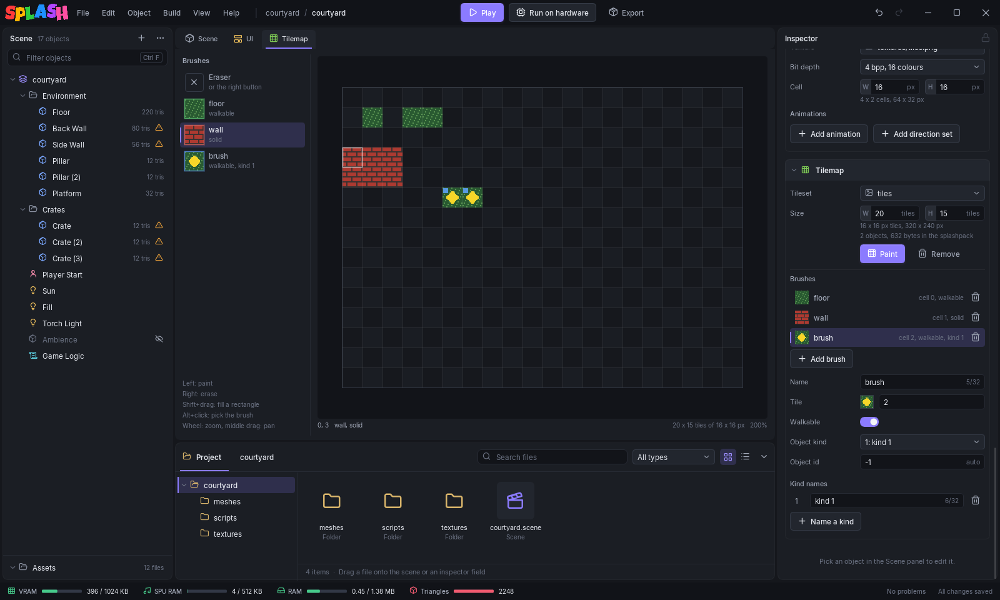

# Tilemaps

A **tilemap** is a grid of tiles drawn from the cells of one [sprite sheet](sprites.md), the sheet's cell size being the tile size. The engine draws it as a 2D floor behind every sprite, and Lua asks it two things: which pixels can be walked on, and where its tagged **objects** are (a spawn point, a pickup, a switch). A scene has at most one tilemap.



Each cell of the map holds a **brush**. A brush says which tileset cell to draw, whether the cell is walkable, and whether it is an object. You set up the brushes in the scene inspector and paint with them in the **Tilemap** tab.

## The Tilemap section

The map belongs to the scene. With nothing selected (**Edit > Select None**, or click empty space in the viewport) the inspector shows the scene settings; the **Tilemap** section is among them, under **Sprite sheets**.

**Add tilemap** makes a 20 x 15 map (a 320 x 240 screen of 16 px tiles), all empty, drawn from the scene's first sprite sheet, with two brushes: `floor` on cell 0, walkable, and `wall` on cell 1, solid. Until the scene has a sprite sheet the button does nothing and the section says "Add a sprite sheet first: the tiles are drawn from its cells." **Paint** opens the Tilemap tab; **Remove** deletes the map with its brushes and cells (Ctrl+Z brings it back).

| Field | Meaning |
|-------|---------|
| **Tileset** | The sprite sheet the tiles are drawn from. Its cell size is the tile size. Renaming the sheet keeps it picked. |
| **Size** | Width (**W**) and height (**H**) in tiles, 1 to 256 each. A smaller size cuts the map at the right and bottom; the cells both sizes share are kept. |

Under the size, two lines give the tile size and the map in pixels ("16 x 16 px tiles, 320 x 240 px"), then the object count and what the map adds to the splashpack ("2 objects, 632 bytes in the splashpack": 20 bytes, plus 2 a cell, plus 6 an object).

Every change in the section is one undo step.

## Brushes

The **Brushes** list shows each brush with its tile, its cell number, walkable or solid, and its kind when it has one. Click one to edit it; the bin deletes it, and the cells painted with it become empty. **Add brush** adds one called `brush` (numbered if taken) that draws the cell after the last brush's (back to cell 0 past the end of the sheet).

| Field | Meaning |
|-------|---------|
| **Name** | Shown in the palette; only for you. Up to 32 characters. |
| **Colour** | The brush's colour in the palette and on object cells in the Tilemap tab. Only for you: the game draws tiles untinted. Right-click the swatch to copy or paste a colour. |
| **Tile** | The tileset cell it draws, row by row from 0 at the top left. Click the thumbnail to pick the cell from the tileset, or type the number. -1, or **Hole (draws nothing)** in the picker, draws nothing (a hole). |
| **Walkable** | On: a player can stand here. Off: a wall; `Tile.MoveActor` stops at it. |
| **Object kind** | 0, **(none)**: a plain tile. Anything else makes each cell painted with it an object Lua finds with `Tile.ObjectCount` and `Tile.ObjectAt`. The game decides what a kind means. |
| **Object id** | Only for a brush with a kind. The id `Tile.ObjectAt` gives each of its cells, 0 to 255; -1 (**auto**) numbers them 1, 2, 3 in reading order, per kind. |

An empty cell, and a cell whose brush is a hole, draws nothing and is solid, whatever the brush's **Walkable** says. A hole brush makes no objects either.

### Kinds and ids

The engine never interprets a kind or an id: they are two numbers, 0 to 255, that it stores and hands back. Pick a number for each kind of thing your game places on the map (1 for spawn points, 2 for coins, say) and give the brush that kind.

At export, every cell painted with a brush that has a kind becomes one object, in reading order: rows from the top, each row left to right. A brush with an **Object id** of -1 numbers its cells per kind as they come in that order, 1, 2, 3, counting every auto-numbered cell of that kind whatever brush painted it. A brush with a fixed id gives all its cells that id, and does not move the count, so mixing fixed and auto ids in one kind can give two objects the same id.

**Kind names** are labels for the kind numbers, shown in the **Object kind** list and the palette. They are for you only; the engine and Lua see the numbers. **Name a kind** adds a label for the next number ("kind 1", "kind 2"), and the bin on the last one removes it.

## The Tilemap tab

While the scene has a tilemap, a **Tilemap** tab sits beside the **Scene** and **UI** tabs. It shows the map with the tileset in its PS1 colours, on a checkerboard where nothing is drawn, with grid lines on the tile edges, a dark and a light line so they show over busy tiles. **Grid** at the top right hides and shows them. The setting belongs to the editor view; the scene file never stores it. Cells painted with a brush that no longer exists, or whose cell is past the end of the sheet, show red. Object cells have a small square of their brush's colour in the top left corner.

The palette on the left lists the **Eraser** and every brush with its tile, walkable or solid, and its kind and id. Click one to paint with it.

Above the palette are four tools:

| Tool | Left button | Right button |
|------|-------------|--------------|
| **Paint** | Paints the selected brush; dragging paints every cell along the way. | Erases. |
| **Rectangle** | Drag a rectangle, filled with the brush on release. | The same, filled empty. |
| **Fill** | Fills the area of matching cells under the pointer with the brush: every cell reachable across edges (not corners) that holds the same brush as the clicked one, or is empty like it. | The same area, erased. |
| **Pick** | Picks the brush of the cell under the pointer (the Eraser for an empty cell), then goes back to Paint. | Erases. |

These work in every tool:

| Control | Does |
|---------|------|
| Shift+drag | Fills a rectangle on release, with the brush (left button) or empty (right button). |
| Alt+click | Picks the brush of the cell under the pointer (the Eraser for an empty cell). |
| Wheel | Zooms about the pointer, from 25% to 1600%. |
| Middle drag | Pans. |

A stroke, from press to release, is one undo step, and so is a rectangle or a fill. The line under the map shows the cell under the pointer ("0, 3   wall, solid", or "empty") and, on the right, the map's size, tile size and zoom.

## Export

The section lists what export would refuse as you type, and export stops on the same errors:

- "The tilemap has no tileset: pick the sprite sheet its tiles are drawn from"
- "The tilemap's tileset '...' is not one of the scene's sprite sheets: pick one"
- "Tile brush '...' draws tileset cell N, but '...' has C (0..C-1)": the brush's cell is past the end of the sheet.
- "Tile brush '...' draws tileset cell N: use -1 for a hole": a cell below -1, only possible by editing the scene file.
- "N tilemap cells are painted with a brush that no longer exists: repaint or erase them": also only from the scene file, since deleting a brush in the editor empties its cells.
- "N tilemap object tiles, psxsplash holds at most 128: paint fewer cells with brushes that have a kind"

The tileset is a sprite sheet like any other, so everything in [Limits and build errors](sprites.md#limits-and-build-errors) applies to it too.

`splashpack-cli export <scene> -o <out.splashpack> --stats` prints a line for the map when the scene has one:

```
tilemap 20x15 tile=16x16 sheet=0 objects=2 bytes=632
```

`sheet` is the tileset's index among the scene's sprite sheets.

The **UI** tab draws the map under the canvases, the way the game does: from pixel 0, 0, untinted, with the canvases on top.

In the scene file the map is the `tilemap` key, its cells one string a row with the brush index of each cell (-1 empty), so it reads as a grid.

## The map in the game

The map's top left corner is at pixel 0, 0, and it uses the same pixel space as the [sprites](sprites.md): the view offset (`Sprite.SetViewOffset`) scrolls the map and the sprites together. Lua's x is across the map and z down it: tile column `x` covers pixels `x * tileW` to `x * tileW + tileW - 1`. `Tile.MoveActor` moves an actor on the world X and Z axes in whole units, so an actor at X = 40, Z = 40 stands in tile 2, 2 of a 16 px map. Off the map is not walkable, so its edge is a wall.

```lua
-- Scene script: put a coin sprite on every kind 2 object.
local COIN = 2

function onSceneCreationEnd()
    if not Tile.Active() then return end
    for i = 1, Tile.ObjectCount() do
        local kind, id, x, z = Tile.ObjectAt(i)   -- x, z: the tile's centre in pixels
        if kind == COIN then
            local s = Sprite.Create("coins")
            Sprite.SetPos(s, x - 8, z - 8)         -- SetPos is the top left corner
        end
    end
end
```

`Tile.ObjectAt` counts from 1. Loop to `Tile.ObjectCount()` and do not ask past it: an index out of range returns a value that is not `nil`. The other functions, with their arguments and what they return without a map, are in the [`Tile` API](../lua/api-reference.md#tile).
