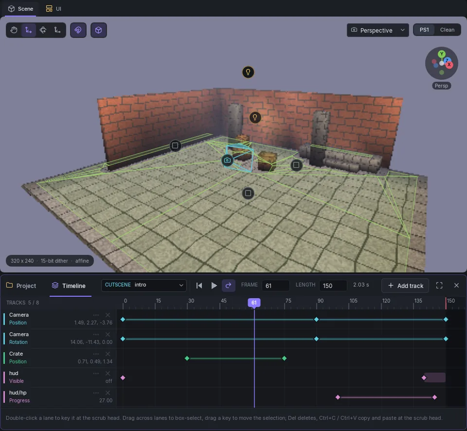

# Cutscenes & Animations



The **Timeline** panel animates a scene: moving the camera, objects and lights, showing and hiding UI, filling a progress bar, playing sounds and skinned-mesh clips, rumbling the controller. It docks as a second tab beside the **Project** panel.

There are two kinds of sequence, built the same way:

| | **Cutscene** | **Animation** |
|-|--------------|---------------|
| Played from Lua with | `Cutscene.Play(name)` | `Animation.Play(name)` |
| At a time | One | Up to 8 |
| Camera tracks | Yes | No |
| Audio events | Yes | No |

Use a cutscene for a scripted moment that takes over the camera. Use animations for things in the world: a door swinging, a lift, a pulsing light.

## Opening and creating

Open the panel from **View > Timeline** (it lists every cutscene and animation), or press **Edit in timeline** next to a sequence in the scene settings under **Cutscenes and animations**. **New cutscene** and **New animation** create one. Double-click the name to rename it; Lua plays it by that name. Names are 1 to 24 characters.

## The panel

The top bar has the sequence picker (**CUTSCENE** or **ANIMATION** and its name), **Back to frame 0**, **Play / Pause** (**Space**), **Loop**, the current **Frame**, the **Length** in frames and its time in seconds, **Add track** and a button to fit the whole length in the panel. Frames run at **30 per second**.

Below, the tracks run down the left and time runs across. The red line is the scrub head. Click or drag in the ruler to scrub: the **Scene** view poses the cameras, objects, lights and UI at that frame, and restores everything when you stop. Nothing is changed in the scene itself.

## Tracks

**Add track** asks for a property and a target. A track drives one property of one target.

| Group | Properties | Target |
|-------|------------|--------|
| Camera | Position, Rotation, H (field of view) | none (cutscenes only) |
| Object | Position, Rotation, Active, UV Offset | An object with a mesh |
| UI | Canvas Visible, Element Visible, Progress, Position, Colour | A canvas, or `canvas/element` |
| Light | Position, Colour, Intensity, Radius, Enabled | An object with a [runtime light](lighting.md#runtime-lights) |
| Rumble | Small motor, Large motor | none |

A sequence has at most 8 tracks, with 64 keys on each. The count shows as **TRACKS 5 / 8**. Object and light positions must stay within 8 x the scene's [GTE scaling](scene-settings.md#rendering) of the origin. A track's right-click menu has **Remove track** and **Drive instead**, which points the track at another target.

## Keys

- **Double-click a lane** to put a key at the scrub head.
- Drag a key to move it. Drag across lanes to box-select; dragging one moves the selection. **Del** deletes it.
- **Ctrl+C** and **Ctrl+V** copy keys and paste them at the scrub head.
- Select a key and the row at the bottom of the panel shows its **VALUE** and its **CURVE**: the interpolation from the previous key into this one, **Linear**, **Step**, **In**, **Out** or **In-out**. On/off tracks hold each key until the next.

## Audio and skin events (cutscenes)

Cutscenes also have an **EVENTS** lane. **Audio event** plays an [audio clip](audio.md) by name at a frame, with a volume and a pan. **Skin clip event** starts a clip on a [skinned object](skinned-animation.md) at a frame, looping or not. Animations take skin clip events but no audio.

A cutscene holds at most 64 audio events and 16 skin events, and a scene at most 16 cutscenes.

## From a script

```lua
Cutscene.Play("intro", {
    onComplete = function()
        Scene.Load(1)
    end
})
Animation.Play("lift")
```

In the [block editor](block-editor.md), **play cutscene** does the same. See the [`Cutscene`](../lua/api-reference.md#cutscene) and [`Animation`](../lua/api-reference.md#animation) APIs.

!!! note "Export checks"
    An export stops with an error when a track targets an object, canvas, element or clip that does not exist, or when an animation holds a camera track or an audio event.
