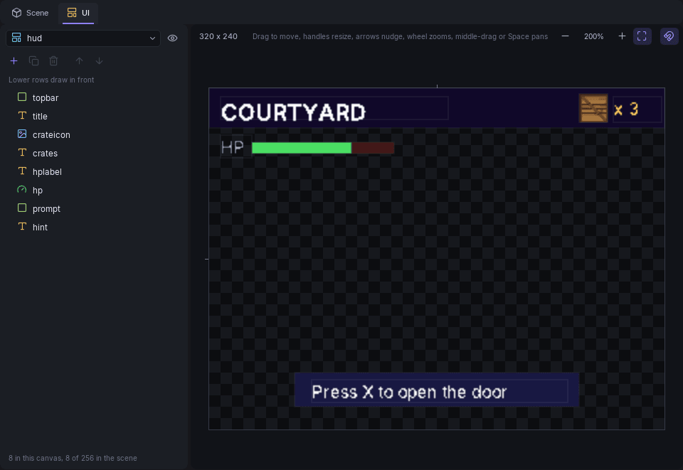

# UI Canvases



A **canvas** holds the HUD, menus and prompts drawn over the game. The **UI** tab next to **Scene** edits them at PS1 resolution (320 x 240), so what you place is where it lands on the console.

A scene can have up to 24 canvases and 256 elements in total (255 in one canvas).

## The tab

- **Canvas picker** (top left): the canvas being edited. The menu has **New canvas** and **Delete this canvas**; the eye next to it sets whether the canvas is visible when the scene starts.
- **Element list**: the canvas's elements. **Lower rows draw in front.** Use **+** to add an element, the copy and trash buttons to duplicate and delete, and the arrows to change the order (**Ctrl+[** sends backward, **Ctrl+]** brings forward).
- **Canvas view**: the screen. Drag an element to move it, drag its handles to resize it, nudge with the arrow keys. The wheel zooms, middle-drag or **Space**+drag pans, **Ctrl+1** is 100%, **Ctrl+0** fits. **Ctrl+C**, **Ctrl+X**, **Ctrl+V** and **Ctrl+D** copy, cut, paste and duplicate. Hold **Ctrl** to toggle snapping while dragging.
- The inspector shows the selected element's properties, with its name at the top (**F2** renames the selected row too). With no element selected it shows the canvas's own: its name, **Visible** and **Sort order**.

## Elements

| Element | Draws |
|---------|-------|
| **Box** | A solid rectangle |
| **Text** | A line of text: ASCII, at most 63 bytes |
| **Image** | A texture from the project |
| **Progress bar** | A bar filled from 0 to 100 |
| **Line** | A line between two points, with a handle at each end |

All elements have a **Name** (what Lua and timeline tracks find them by), **Visible**, **Position** and **Size** in pixels, an **Anchor** (what the position stays relative to if the screen size changes; stretched sides follow both edges) and a **Colour**.

Per type:

- **Text** has the **Text** itself and a **Font**: the built-in system font (8 x 16, fixed width), or one of the scene's fonts. Fonts live in the scene file; see the scene format notes in the editor's repository. At most 3 fonts per scene.
- **Image** has a **Texture** (**Browse** copies a file from outside the project into `textures/`), **Native size**, **Bit depth** (4 and 8 bpp use a palette and less VRAM) and **Cutout** (transparent texels, alpha under half, are left out instead of drawn black). Set **Sheet** to one of the scene's [sprite sheets](sprites.md) and the Image shows a single cell instead: click the cell in the picker, and **Snap size** sets the size to one cell. Renaming the sheet carries the Images along. A **Colour** of `#808080` draws the texture as it is; brighter values brighten it, up to double at white.
- **Progress bar** has a **Value**, 0 to 100.

## Canvases

**Visible** is whether the canvas shows when the scene starts. **Sort order** runs from 0 at the back to 255 in front; canvases with higher orders draw over lower ones.

## Driving the UI

From Lua, find a canvas and an element by name, then change them:

```lua
local hud = UI.FindCanvas("hud")
local bar = UI.FindElement(hud, "hp")
UI.SetProgress(bar, 75)
UI.SetText(UI.FindElement(hud, "crates"), "x 3")
```

[Timeline tracks](timeline.md#tracks) can also animate an element's visibility, position, colour and progress. See the [`UI` API](../lua/api-reference.md#ui).

## Prompts and loading screens

- An [Interactable](objects.md#interactable) can show a canvas as its prompt while the player is in range. The canvas name must fit in 15 characters.
- A canvas can be the scene's [loading screen](scene-settings.md#loading-screen). The progress bar on it must be named `loading`.
